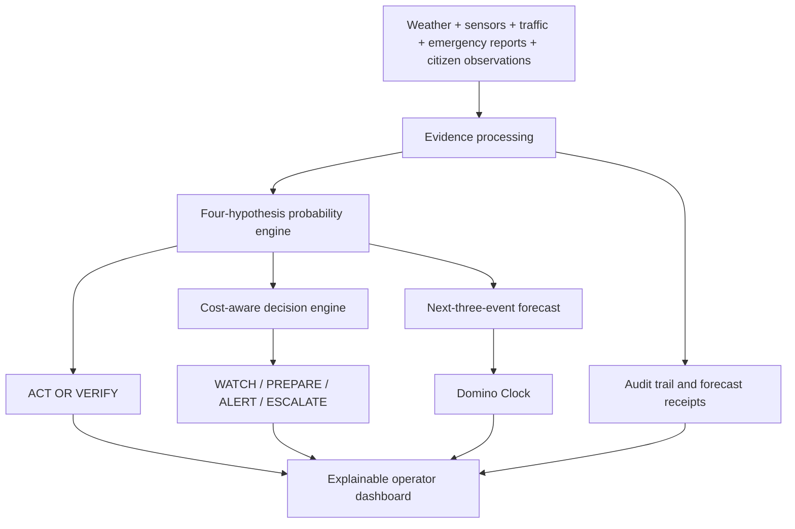

<div align="center">

# BEFOREPOINT

### DETECT. VERIFY. DECIDE.

**Explainable early-crisis intelligence for the first ten minutes.**

*CASCADE ’26 · IIIT Nagpur · Theme 2 — Crisis Before Crisis · Problem 2.1 — The First 10 Minutes*

[Explore the problem](#the-problem) · [How it works](#how-beforepoint-works) · [Key features](#key-features) · [Run locally](#run-locally) · [Demo](#three-minute-judge-demo)

</div>

---

> [!IMPORTANT]
> **Research and simulation prototype — not an operational emergency-warning system.** Crisis events, infrastructure relationships, neighborhood placements, predicted impacts, and response actions in the demonstration are simulated or illustrative. Real weather and map context must be distinguished from synthetic incident data. BEFOREPOINT does **not** issue public emergency warnings.

## The problem

A possible disaster rarely starts with one clear warning. During the **first ten minutes**, emergency officers may see scattered, unreliable and delayed signals:

| Time | Incoming signal | Why it is ambiguous |
|:--|:--|:--|
| 00:00 | Heavy rainfall | Rain does not always lead to a crisis. |
| 00:03 | Unusual drainage readings | The water level may be rising — or the sensor may be faulty. |
| 00:05 | Traffic slows down | It could be weather, a local incident or a developing closure. |
| 00:07 | Emergency calls increase | Some reports may be duplicated or unrelated. |
| 00:09 | Hospitals report unusual activity | It may or may not be connected to the same event. |

**The difficult question is not simply “Is something wrong?” It is “What should we believe, what might happen next, and when is it worth acting?”**

Reacting too early can create unnecessary alerts and resource costs. Reacting too late can leave little time to prepare.

## Our solution

BEFOREPOINT is a **decision-support research platform** that continuously processes incoming evidence, estimates competing explanations, forecasts possible infrastructure disruptions and recommends an action under explicit cost assumptions.



### Four possible explanations

The model maintains probabilities for **four competing hypotheses**, updating them when new information becomes available:

| Hypothesis | In simple words | Example |
|---|---|---|
| **Noise** | No meaningful crisis is established. | Ordinary rain-related traffic delays. |
| **Sensor failure** | Faulty devices or shared infrastructure explain the reports. | Several sensors lose one common gateway. |
| **Isolated incident** | A real but localized problem. | One waterlogged underpass. |
| **Cascading crisis** | A problem may trigger disruptions elsewhere. | Drainage overload → road closure → dispatch delays. |

The probabilities represent **model estimates**, not certified real-world disaster probabilities. A sensor fault may also coexist with a genuine incident.

### Four recommended response levels

| Action | Intended meaning |
|---|---|
| **WATCH** | Continue monitoring and collecting evidence. |
| **PREPARE** | Begin proportionate, low-cost readiness measures. |
| **ALERT** | Recommend notifying relevant responsible authorities. |
| **ESCALATE** | Recommend urgent higher-level consideration and coordination. |

The decision engine compares **expected losses** under configured false-alarm, delay and response-cost assumptions; it does not rely only on a single crisis-probability threshold. Recommendations are **simulated and advisory**, never automatic public warnings.

## Key features

### 1. ACT OR VERIFY — our central innovation

**Is one more observation worth the time it takes?**

When evidence is uncertain, another independent sensor check might prevent a costly false alarm — but waiting might also waste the last useful preparation window. BEFOREPOINT evaluates verification options against information value, source reliability, delay and operational costs.

Possible outcomes include **verify first**, **prepare now**, and **verify while preparing**.

### 2. Twin Test — no peeking at the future

Two simulated scenarios share **identical observable evidence for the first seven minutes**. Their outcomes later diverge: one develops into a cascading crisis; the other has a less severe explanation.

The model must produce identical outputs for identical early inputs and change its assessment only after new evidence arrives. This helps detect accidental future-information leakage.

### 3. Domino Clock — what could happen next?

Forecasts the **next three possible infrastructure disruptions**, each with an estimated probability and time window. The current demonstration uses **manually configured, illustrative dependencies**, not automatically learned real-city infrastructure connections.

### 4. Reliable evidence processing

Handles and tests cases involving:

- Delayed and out-of-order reports, duplicates and retractions
- Missing sensors and shared-gateway/common-cause failures
- Source reliability changes and shifting background conditions
- Contradictory observations and misleading report patterns

**Missing information is not treated as proof of safety.**

### 5. Silent Zone — structural vulnerability context

Shows how the consequences of an incident may differ across simulated neighborhoods depending on road alternatives, backup power, service access and available observations. **Structural vulnerability is not the same as incident probability.**

### 6. Evaluation and forecast receipts

Supports reproducible simulation runs, probability/decision evaluation, and records of what the model predicted using information available at the time. These receipts make forecasts inspectable; they do not guarantee correctness.

## Scope: 2.1 first, 2.2 and 2.3 as extensions

| Challenge | Role in BEFOREPOINT | Current scope |
|---|---|---|
| **2.1 — The First 10 Minutes** | **Primary submission** | Four-hypothesis inference, unreliable streams, action decisions, next-three-event forecasts, Twin Test and evaluation. |
| **2.2 — The 72-Hour Warning** | Inspiration for longer-term cascade intelligence | Domino Clock is a **limited short-term** dependency forecast. It does not establish complete 72-hour prediction, automated dependency discovery or intervention optimization. |
| **2.3 — The Critical 1%** | Inspiration for vulnerability-aware decisions | Silent Zone uses **illustrative neighborhood-level structural information**. It does not establish full privacy-preserving federated learning or the complete 2.3 requirements. |

## Technology

| Layer | Technology / role |
|---|---|
| **Frontend** | React, TypeScript, Vite; interactive command center and visualizations |
| **Backend** | Python, FastAPI; event processing, probabilistic inference, decisions and simulation |
| **Local persistence** | SQLite; local research/demo state and audit data |
| **Weather context** | Open-Meteo (provider data, separate from synthetic incidents) |
| **Maps** | MapTiler / MapLibre GL JS; basemap and illustrative overlays |
| **Notifications** | Firebase Cloud Messaging integration; actual backend push delivery requires configured trusted server credentials |
| **Testing** | Python tests under `backend/tests/`; frontend tests under `frontend/tests/` |

## Repository structure

```text
BEFOREPOINT/
├── backend/
│   ├── sentinel/           # API, inference, decisions, simulator, evaluation
│   ├── tests/              # Backend and integration tests
│   ├── .env.example        # Safe server configuration example
│   └── requirements-lock.txt
├── frontend/
│   ├── src/                # React pages, components and client utilities
│   ├── public/             # Public static assets
│   ├── tests/              # Frontend tests
│   ├── .env.example        # Public/frontend configuration example
│   └── package.json
├── docs/                   # Supporting project documentation
├── dashboard.png          # Dashboard screenshot
├── run.sh                 # Project startup script
├── .gitignore
└── README.md
```

*The internal Python package retains the historical name `sentinel` for compatibility. The product's public name is **BEFOREPOINT**.*

## Run locally

### Requirements

- Python 3 and `pip`
- Node.js and `npm`
- Git
- Optional credentials/configuration for the external services you want to demonstrate

```bash
# 1. Clone the project
git clone https://github.com/Its-AtharvDeshmukh/BEFOREPOINT.git
cd BEFOREPOINT

# 2. Inspect the project's existing launcher and configuration
cat run.sh
cat backend/.env.example
cat frontend/.env.example

# 3. Use the repository's startup script after reviewing it
bash run.sh
```

The repository contains `run.sh`, but its exact dependency-installation behavior and port assignments should be checked in the script and `docs/` before use. For manual development, install dependencies from `backend/requirements-lock.txt` and `frontend/package-lock.json`, then use the actual launch scripts and API entry point defined in the source. **Do not assume live integrations are connected merely because the application starts.**

### Configuration safety

- Keep actual `.env` files **outside Git**; use the supplied `.env.example` templates.
- Keep Firebase Admin service-account JSON **server-side and outside the repository**.
- Restrict MapTiler/browser-exposed API keys to approved origins where supported.
- Do not commit local SQLite databases, private keys or generated frontend `dist/` output.
- Firebase browser setup and permissions **do not by themselves prove server-side push delivery is configured**.

## Three-minute judge demo

1. Open **Command Center → Simulation Lab** and reset the selected scenario.
2. Advance the early minutes to show rain, drainage, traffic and emergency evidence arriving.
3. Explain the **four changing probabilities** and a shared-gateway/missing-data case.
4. Show the **cost-based WATCH / PREPARE / ALERT / ESCALATE** recommendation.
5. Open **ACT OR VERIFY** to compare the value of checking another source versus preparing now.
6. Open **Domino Clock** for the next three possible disruptions and their time windows.
7. Run the **Twin Test** to demonstrate identical early outputs before the scenarios diverge.
8. Open **Evaluation / Forecast Receipts** to show how the model's earlier predictions are assessed.


*Screenshot from the local research application; map overlays and crisis assessments are illustrative.*

## Evaluation and limitations

An earlier development run **reported** passing backend and frontend test suites and a crisis Brier score of **0.135** on simulated benchmarks, compared with **0.171** and **0.231** for two baselines. The same report noted **higher false-alarm rates than both baselines** and that one ablation achieved lower decision cost. These are **reported local research results, not independently reproduced here**, and should be refreshed from the current test run before use in a judged performance claim.

Known boundaries:

- Synthetic incidents are **not** validated municipal emergency data.
- The inference model uses illustrative priors, likelihoods and cost assumptions.
- Infrastructure links and neighborhood conditions are simulated or manually configured.
- Forecasts are estimates with uncertainty, not guaranteed future outcomes.
- No automated public emergency broadcast or operational deployment is provided.
- Real-world use would require authorized agency data, extensive temporal validation, calibration, independent review and operational safeguards.

## Project principles

**Evidence before certainty. Explainability before automation. Human oversight before public action.**

BEFOREPOINT is built to ask a better question at the beginning of a crisis:

> **“Given what we know right now, is it better to verify, prepare, or escalate?”**

---

<div align="center">

**BEFOREPOINT** · **DETECT. VERIFY. DECIDE.**

*Built for CASCADE ’26 · IIIT Nagpur*

</div>
