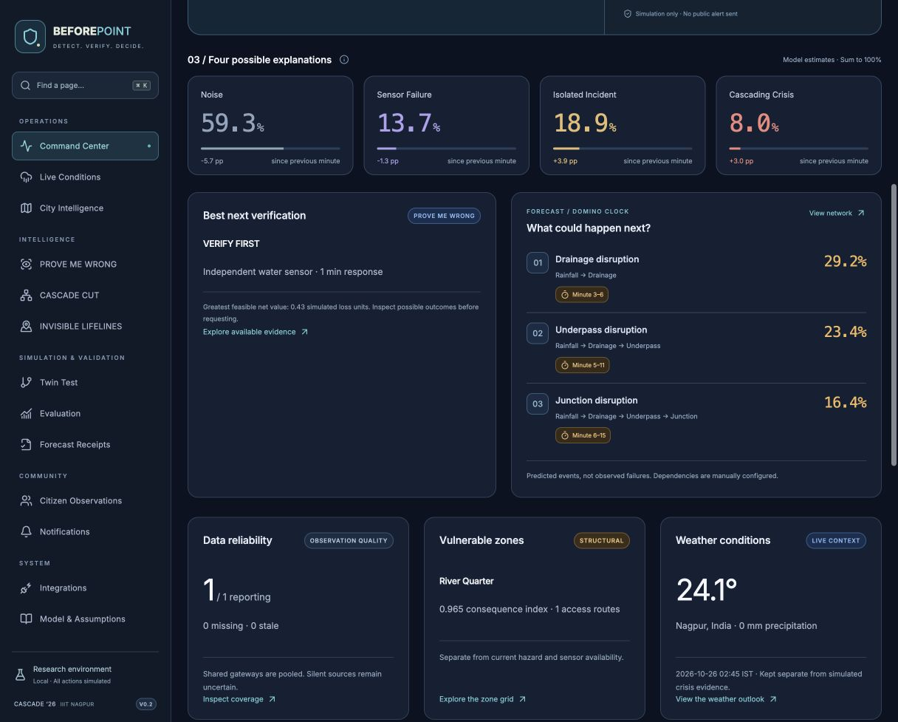
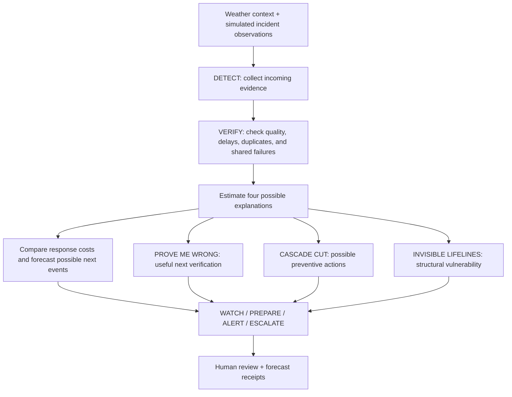
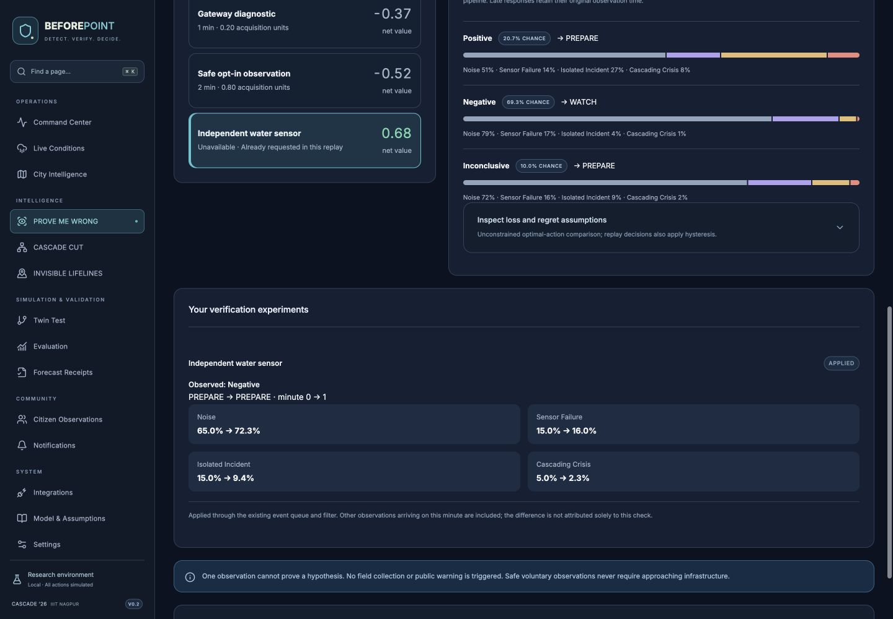
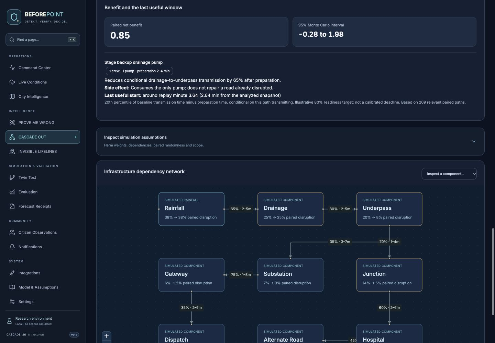
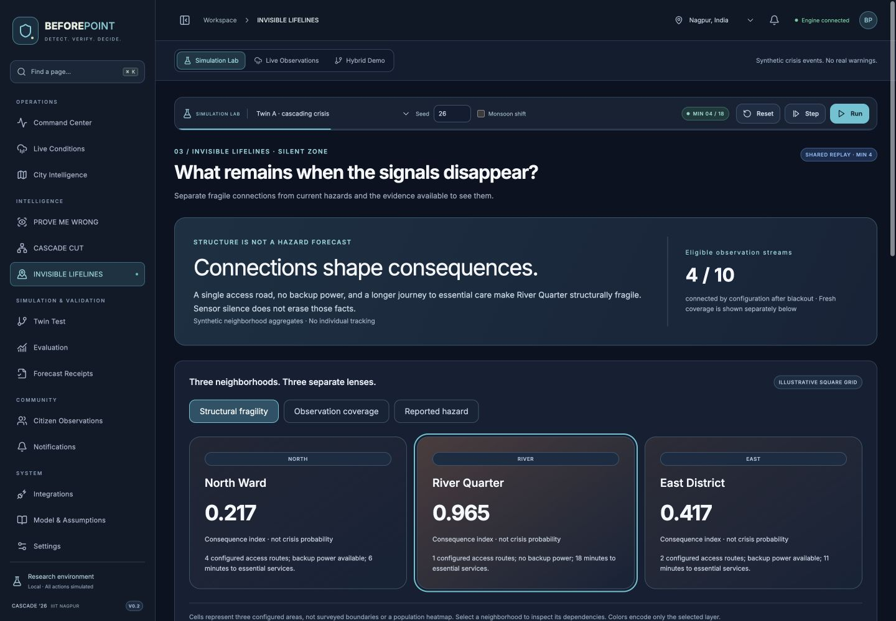
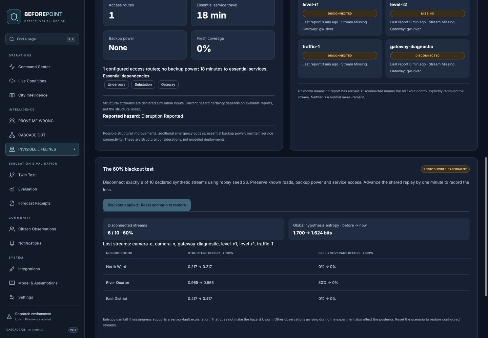

<div align="center">

# BEFOREPOINT

### DETECT. VERIFY. DECIDE.

**Explainable early-crisis intelligence for better decisions in the first ten minutes.**

**CASCADE '26 · IIIT Nagpur · Theme 2 — Crisis Before Crisis**  
**Primary challenge: 2.1 — The First 10 Minutes**

[The Problem](#the-problem) · [How It Works](#how-beforepoint-works) · [Three Flagship Features](#three-flagship-features) · [Explore the App](#explore-the-app) · [Run Locally](#run-locally) · [Limitations](#limitations-and-responsible-use)

</div>

> [!IMPORTANT]
> **Research and simulation prototype — not an operational disaster-warning system.** BEFOREPOINT supports *human-reviewed* decisions. Its demonstration uses **synthetic crisis events and illustrative infrastructure data**. Weather information from an external provider, when available, is different from simulated emergency observations. **No public emergency warning is issued by this application.**



## In One Minute

Imagine heavy rain begins in a city. A drainage sensor reports unusually high water, traffic slows, and emergency calls increase.

**Is this a real crisis, one isolated problem, faulty equipment, or just noise?**

An emergency team cannot afford to ignore important signs. But responding to every suspicious signal can also waste time and resources.

**BEFOREPOINT helps by:**

1. **Detecting** early signals from available observations.
2. **Verifying** how reliable those signals are.
3. **Estimating** what might be happening and what could happen next.
4. **Comparing** the cost of acting now with the cost of waiting.
5. **Recommending** an understandable next step for a person to review.

Its goal is simple: **better evidence, better preparation, better decisions.**

## The Problem

### The first 10 minutes are full of uncertainty

An illustrative Nagpur monsoon simulation begins like this:

| Time | What arrives | Why the situation is unclear |
| :--- | :--- | :--- |
| **00:00** | Heavy rainfall | Heavy rain does not always create a disaster. |
| **00:03** | Unusual drainage readings | Water may be rising, or a sensor may be faulty. |
| **00:05** | Traffic slows | It may be ordinary congestion or a road disruption. |
| **00:07** | Emergency reports increase | Some reports may be duplicates or unrelated. |
| **00:09** | Essential-service signals appear | The events may—or may not—be connected. |

Emergency teams face two costly mistakes:

- **Act too early:** false alarms, wasted resources, and warning fatigue.
- **Act too late:** lost preparation time and possibly greater disruption.

The challenge is **not simply to send more alerts**. It is to decide what to believe, what to check, and what action is justified *before the full situation is known*.

## How BEFOREPOINT Works



These features provide **complementary views of the same simulated situation**, rather than three unrelated applications or a rigid sequence of automatic actions.

### 1. Four possible explanations

Instead of jumping straight to “disaster detected,” the inference engine considers four competing hypotheses:

| Hypothesis | Simple meaning | Example |
| :--- | :--- | :--- |
| **NOISE** | The signals may be ordinary or misleading. | Rain-related traffic delays. |
| **SENSOR FAILURE** | A device or shared network may be failing. | Multiple sensors depend on one faulty gateway. |
| **ISOLATED INCIDENT** | One real, local problem may exist. | A waterlogged underpass. |
| **CASCADING CRISIS** | A problem may spread to connected services. | Drainage overload → road disruption → emergency vehicle delay. |

The model updates these estimated probabilities when new observations arrive. Their sum is 100%. They are **model estimates under research assumptions**, not certified disaster probabilities for a real city.

### 2. Reliability before confidence

Five warnings do not necessarily mean five independent confirmations. If five sensors depend on the same faulty gateway, the readings could share a single cause.

The evidence-processing layer accounts for cases such as:

- Duplicate, delayed, retracted, and out-of-order reports.
- Missing observations and contradictory signals.
- Shared-gateway and other common-cause failures.
- Changing source reliability and background conditions.

**Missing evidence is not proof of safety. More reports do not automatically mean more trustworthy information.**

### 3. Decisions, not just predictions

The response engine compares possible consequences using configured cost assumptions:

| Response | What it means |
| :--- | :--- |
| **WATCH** | Continue monitoring and collecting information. |
| **PREPARE** | Begin proportionate, low-cost readiness measures. |
| **ALERT** | Recommend notifying the appropriate authorities. |
| **ESCALATE** | Recommend urgent higher-level review and coordination. |

The most likely hypothesis is **not necessarily** the response with the lowest expected cost. For example, preparation might be justified even when there is uncertainty about whether a larger crisis will develop.

**These are simulated, advisory recommendations, not automatic instructions or public warnings.**

## Three Flagship Features

The main submission focuses on **Problem 2.1**. The other two features are **limited, supporting extensions** inspired by Problems 2.2 and 2.3.

### 01 — PROVE ME WRONG

**Problem 2.1 — The First 10 Minutes**  
**Question: “What should we check next to make a better decision?”**

Imagine drainage readings look dangerous, but the system cannot rule out a faulty gateway.

PROVE ME WRONG builds on **ACT OR VERIFY** and compares available checks—for example, an independent water sensor or gateway diagnostics—using their possible results, reliability, delay, and cost.

The important question is not *“Which check gives us the most data?”* It is:

**“Which check could actually change our recommended action?”**

A possible recommendation is **PREPARE WHILE VERIFYING**: begin reasonable, low-cost readiness steps while obtaining useful independent evidence, when the cost model supports doing so.

**What makes it useful:** It connects the *next piece of evidence* to a potential *decision change*. This is an application of established value-of-information ideas, not a claim that we invented them.



### 02 — CASCADE CUT

**Inspired by Problem 2.2 — The 72-Hour Warning**  
**Question: “Which action could reduce the spread of connected failures?”**

A possible simulated chain looks like:

**Heavy rain → drainage overload → road disruption → ambulance delay → reduced hospital access**

**Domino Clock** provides short-horizon forecasts of possible next disruptions. **CASCADE CUT** extends that idea by comparing simulated interventions, such as drainage maintenance, an alternative emergency route, or backup support.

The comparison considers configured resource constraints, preparation time, cost, and possible outcomes **with and without** an intervention.

**Last Useful Window** explores whether starting an intervention later could reduce its modeled benefit.

**What makes it useful:** It moves from *“What could fail?”* to *“Which feasible preparation might help?”*

This is **not** a claim of validated 1–72-hour citywide forecasting, automatically discovered real-world infrastructure dependencies, or proven damage reduction.



### 03 — INVISIBLE LIFELINES

**Inspired by Problem 2.3 — The Critical 1%: Hidden Community Vulnerability**  
**Question: “Which areas have fewer options when infrastructure fails?”**

Two simulated neighborhoods can experience the same rain but face different consequences:

| Area A — More backup options | Area B — Fewer backup options |
| :--- | :--- |
| Several alternative roads | One main access road |
| Backup electricity | Limited backup power |
| Nearby essential services | Fewer service alternatives |

**INVISIBLE LIFELINES** builds on **Silent Zone** and explores structural vulnerability separately from the immediate hazard and the amount of evidence available.

**60% Data Blackout Test:** Disable 60% of simulated observation streams, then show what structural information remains known and where uncertainty has increased.

**Missing data does not automatically mean an area is safe or dangerous.** The illustrative zone information is not a verified assessment of real neighborhoods.

This supporting feature does **not** establish full federated learning, guaranteed privacy, or complete fulfillment of Problem 2.3.





## Explore the App

The interface brings the project together in one place:

| Page / module | What you can do |
| :--- | :--- |
| **Command Center** | View the scenario, current evidence, four hypotheses, and suggested response. |
| **Live Conditions** | View supported weather context, with clear source labeling. |
| **City Intelligence** | Explore a map with illustrative scenario overlays. |
| **PROVE ME WRONG** | Compare potentially useful verification actions. |
| **CASCADE CUT** | Inspect possible failure chains and compare simulated interventions. |
| **INVISIBLE LIFELINES** | Explore structural vulnerability, coverage, and missing-data effects. |
| **Twin Test** | Check that identical early inputs give identical early predictions. |
| **Evaluation** | Review tests, simulated performance, and model limitations. |
| **Forecast Receipts** | Inspect earlier forecasts and the evidence available when they were made. |
| **Citizen Observations** | Explore controlled voluntary report workflows. |
| **Notifications** | Explore notification settings and integration status. |
| **Integrations / Model & Assumptions / Settings** | Inspect configuration, data provenance, and model assumptions. |

The underlying **ACT OR VERIFY**, **Domino Clock**, and **Silent Zone** concepts also support the newer flagship experiences.

### Understanding the modes

- **Simulation Lab:** Runs synthetic crisis scenarios for evaluation and demonstration.
- **Live Observations:** Uses configured, supported external observations where available; it does **not** imply access to official emergency-system feeds.
- **Hybrid Demo:** Combines external context and simulation, which must remain clearly labeled.

The Command Center's **Reset**, **Step**, and **Run** controls help demonstrate how new evidence changes the model's estimates over a scenario.

## A Simple Judge Demo

Use one consistent simulated scenario to show how the features connect:

1. **Open Command Center → Simulation Lab.** Select a scenario and reset it.
2. **Step forward** as rainfall, sensor, traffic, and other observations arrive.
3. **Explain the four probabilities.** Show uncertainty rather than claiming the software already knows the outcome.
4. **Show the response recommendation.** Explain how configured false-alarm and delay costs matter.
5. **Open PROVE ME WRONG.** Compare possible checks and, where supported, apply a simulated observation to update the decision.
6. **Open CASCADE CUT.** Compare possible interventions in the same simulated situation.
7. **Open INVISIBLE LIFELINES.** Show structural vulnerabilities and the simulated 60% data blackout.
8. **Finish with Twin Test, Evaluation, and Forecast Receipts.** Show how forecasts can be inspected and tested.

> **Tip:** Demonstrate only controls and behaviors that work in your current checkout. Do not present example images as proof of a verified live integration.

## Technology

| Layer | Technology | Purpose |
| :--- | :--- | :--- |
| Frontend | React, TypeScript, Vite | Responsive dashboard and user interaction. |
| Backend | Python, FastAPI | APIs, inference, verification, decisions, and simulations. |
| Local data | SQLite | Local research/demo state and audit records. |
| Weather context | Open-Meteo | Provider weather observations or forecasts, where available. |
| Maps | MapTiler / MapLibre GL JS | Basemap and illustrative overlays. |
| Notifications | Firebase Cloud Messaging integration | Browser/notification integration; delivery needs appropriate server configuration. |
| Testing | Python tests, frontend tests | Evaluate expected software behavior. |

### High-level repository layout

```text
BEFOREPOINT/
├── backend/
│   ├── sentinel/              # FastAPI, inference, decisions, and simulator
│   │   ├── prove.py           # Verification decision logic
│   │   ├── interventions.py   # Simulated intervention comparisons
│   │   ├── lifelines.py       # Structural vulnerability analysis
│   │   └── flagship_api.py    # Flagship-related API routes
│   ├── tests/                 # Backend tests
│   └── .env.example           # Safe configuration example
├── frontend/
│   ├── src/                   # React app, pages, and components
│   ├── tests/                 # Frontend tests
│   ├── package.json
│   └── .env.example
├── docs/                      # Design, assumptions, validation, and images
├── dashboard.png
├── run.sh                     # Local project startup script
└── README.md
```

The Python package keeps the historical name `sentinel` for compatibility. **The product name is BEFOREPOINT.**

## Run Locally

### Requirements

- Git
- Python 3 and `pip`
- Node.js and npm
- Optional configuration for weather, maps, and notification services

### 1. Clone the correct repository

```bash
git clone https://github.com/Its-AtharvDeshmukh/BEFOREPOINT.git
cd BEFOREPOINT
```

### 2. Review the startup script and environment examples

```bash
cat run.sh
cat backend/.env.example
cat frontend/.env.example
```

Configure only the integrations you need. **Never commit real secrets** from `.env` files, private keys, or Firebase Admin credentials.

### 3. Start the project

Use the repository's startup script after reviewing it:

```bash
bash run.sh
```

The exact ports, backend entry point, and dependency-installation behavior depend on the checked-in script and local configuration; inspect its output rather than assuming a fixed URL.

### Frontend development (separately)

The frontend's `package.json` is inside **`frontend/`**, not the repository root:

```bash
cd frontend
npm ci
npm run dev
```

Open the local address printed by Vite. Features that call the backend will need the Python API running as well.

> Running `npm run dev` from the repository root will fail with `ENOENT` because the root does not contain the React app's `package.json`.

### Testing

Tests live in `backend/tests/` and `frontend/tests/`. Install the project's dependencies, then use the commands and scripts supplied in the current checkout. For example, inspect frontend scripts with `cd frontend && npm run`. Consult the checked-in [validation documentation](docs/VALIDATION.md) and [Phase 4 delivery notes](docs/PHASE4-DELIVERY.md) before reporting test results.

## Evaluation and Accountability

BEFOREPOINT aims to make its predictions **inspectable**, not unquestionable.

- **Twin Test:** Two scenarios receive the same evidence for the first seven minutes; the model must not use later outcomes to change earlier predictions.
- **Forecast Receipts:** Record what was predicted from the information available at the time.
- **Simulation evaluation:** Compare prediction quality, false alarms, and decision costs against suitable baselines.
- **Ablation checks:** Examine whether a particular component actually improves the measured result.

**Do not assume a better prediction score means every decision is better.** Earlier development reports described improvements on one simulated prediction metric alongside worse false-alarm performance and a decision-cost ablation that needed further analysis. Any numbers shown to judges should come from a **fresh, reproducible run** of the current commit.

See [Phase 4 evaluation notes](docs/PHASE4-DELIVERY.md) and the JSON artifacts in `docs/` for project-specific research outputs.

## Scope Against the Official Challenges

| Challenge | BEFOREPOINT's contribution | Boundary |
| :--- | :--- | :--- |
| **2.1 — The First 10 Minutes** | **Primary submission:** unreliable evidence handling, four hypotheses, response costs, verification, Twin Test, and short-term forecasts. | Research prototype; model calibration and real-world performance remain unverified. |
| **2.2 — The 72-Hour Warning** | **Supporting extension:** Domino Clock and CASCADE CUT explore connected failures and feasible interventions. | Not full 1–72-hour calibrated city forecasting or automatically learned real dependencies. |
| **2.3 — The Critical 1%** | **Supporting extension:** Silent Zone and INVISIBLE LIFELINES explore structural vulnerability and missing evidence. | Not full federated learning or demonstrated re-identification protection. |

## Limitations and Responsible Use

1. **Synthetic events:** Crisis streams, incident outcomes, example asset links, and zone conditions in the demonstration are simulated or illustrative.
2. **External weather is context, not official emergency validation:** Real weather-provider information does not make simulated incidents real.
3. **Model assumptions:** Prior probabilities, source likelihoods, dependency relationships, resource costs, and decision losses need independent validation before real use.
4. **Uncertainty:** A prediction or recommendation can be wrong; missing information must remain visible.
5. **No automatic public warnings:** Actions in the research UI are simulated and remain subject to human review.
6. **Incomplete challenge coverage:** Supporting 2.2 and 2.3 modules must not be represented as complete solutions to their full official specifications.
7. **Operational deployment would require:** Authorized agency data, independent temporal tests, calibration, security/privacy review, resilient infrastructure integrations, and clear responsibility for decisions.

### Configuration and repository safety

- Keep `.env` and `.env.local` out of Git; commit `.env.example` templates only.
- Store Firebase Admin service-account credentials securely on the server, never in browser code or Git.
- Restrict client-exposed map keys to authorized origins where supported.
- Do not commit private keys, local databases, `node_modules/`, or generated `frontend/dist/` assets unless explicitly required by your deployment strategy.
- A working dashboard does not, by itself, prove real-time emergency feeds or operational alert delivery.

## Documentation

- [Model assumptions](docs/MODEL.md)
- [Event handling](docs/EVENTS.md)
- [Integrations](docs/INTEGRATIONS.md)
- [Validation](docs/VALIDATION.md)
- [Backend audit](docs/BACKEND-AUDIT.md)
- [Phase 4 design](docs/PHASE4-DESIGN.md)
- [Phase 4 delivery](docs/PHASE4-DELIVERY.md)

## Project Principle

> **Evidence before certainty. Explainability before automation. Human oversight before public action.**

<div align="center">

### BEFOREPOINT
**DETECT. VERIFY. DECIDE.**

*From uncertain signals to informed action.*

Built for **CASCADE '26 · IIIT Nagpur**  
[GitHub Repository](https://github.com/Its-AtharvDeshmukh/BEFOREPOINT)

</div>
